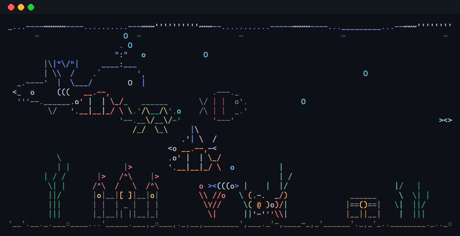

aquarium
========

A little aquarium that lives in your terminal. Watch fish swim around, spot sharks and sea turtles, and see what else is hiding in the tank. There are also jellyfish, decorations, and tiny critters crawling along the bottom.



Getting started
---------------

### Requirements

- Node.js 22 or newer.
- A terminal with ANSI color support (true color recommended).

The easiest way to try it is with `npx`:

```sh
npx @yiliya/aquarium
```

If you'd rather have it available as a command, install it globally:

```sh
npm install -g @yiliya/aquarium
aquarium
```

Controls
--------

| Key | Action |
| --- | --- |
| `+` or `space` | Add another fish |
| `-` | Remove a fish |
| `r` | Rearrange the tank |
| `p` | Pause or resume |
| `?` | Show or hide the controls |
| `q` or `esc` | Leave the aquarium |

Options
-------

```sh
-f, --fish <n>      Number of fish to start with (default: based on tank size)
-s, --seed <seed>   Generate a specific tank using a number or word
    --fps <n>       Set the frame rate, from 1 to 30 (default: 12)
    --height <n>    Set the tank height in rows (default: fill the terminal)
    --no-color      Disable colors (also respects NO_COLOR)
-h, --help          Show help
-v, --version       Show version
```

Every tank has a seed. On wider terminals, you'll find the current seed in the status bar. Pass it to `--seed` whenever you want to bring back the same layout.

You can also save a snapshot instead of running the animation. When the output is piped or redirected, aquarium prints a single frame:

```sh
aquarium --seed nemo > tank.txt
```

Development
-----------

Start by installing the dependencies:

```sh
npm install
```

Scripts:

```sh
npm run dev        # Run the aquarium from source
npm run preview    # Print a single frame
                   # Usage: npm run preview -- <width> <height> <seconds> <seed>
npm run gallery    # Preview every fish, decoration, and critter
npm test           # Run the tests
npm run typecheck  # Check TypeScript types
npm run build      # Compile everything into dist/
```

### Project structure

```
src/
├─ cli.tsx              Reads the flags, then starts the app (or prints a snapshot)
├─ app.tsx              Main app: clock, keys, resizing, status bar
├─ components/Tank.tsx  Turns a grid of characters into colored text
├─ art/                 The fish, decorations, and critters (just data)
│  ├─ fish.ts
│  ├─ scenery.ts
│  └─ critters.ts
└─ core/                The simulation, in plain TypeScript
   ├─ sim.ts            Creating, stepping, and resizing the tank
   ├─ fish.ts           Swimming, turning, wandering, coming and going
   ├─ critters.ts       Walking and resting on the sand
   ├─ bubbles.ts        Rising, wobbling, and popping
   ├─ decorations.ts    Animations, bubble vents, and the chest opening
   ├─ layout.ts         Placing the scenery to fit any width
   ├─ plants.ts         Swaying kelp and sea grass, drawn with math
   ├─ render.ts         Drawing the world into a grid, layer by layer
   ├─ catalog.ts        defineFish, defineDecoration, and defineCritter
   ├─ art.ts            Turning drawings into sprites, and mirroring them
   ├─ grid.ts           The character grid everything is drawn into
   ├─ world.ts          The shape of the tank's state
   ├─ palette.ts        Color names
   ├─ rng.ts            Seeded random numbers
   ├─ math.ts           Small helpers (mod, clamp)
   └─ *.test.ts         Tests
scripts/                The preview and gallery tools
docs/                   GIF for README
```

Every frame, `step(world, dt)` moves everything forward by `dt` seconds, then `renderWorld(world)` draws it. Speeds are measured per second, so the tank moves at the same pace at any frame rate. Randomness is seeded, so the same seed always builds the same tank.

Custom Fish
-----------

You can add new fish in [`src/art/fish.ts`](src/art/fish.ts). Each fish has a name, a few animation frames, colors, and settings that control how it swims around.

Here's a small example:

```ts
const fih = defineFish({
  name: "fih",
  frames: [
    // Draw it facing right, it'll be mirrored automatically
    String.raw`
        _,--._
      \/ :  : 'o.
      /\_:__:_._.'
    `,
    String.raw`
        _,--._
      -/ :  : 'o.
      -\_:__:_._.'
    `,
  ],
  colors: { ":": "accent" },
  schemes: [{ body: "lavender", accent: "mint" }],
  speed: [2, 3], // Cells per second
  depth: [0.3, 0.9], // 0 = surface, 1 = floor
});
```

Once you've added your fish, include it in the `SPECIES` list at the bottom of the file.

The same general setup applies to other things in the aquarium:

- **Decorations:** [`src/art/scenery.ts`](src/art/scenery.ts)
- **Sand critters:** [`src/art/critters.ts`](src/art/critters.ts)

For a full list of available settings, check out [`src/core/catalog.ts`](src/core/catalog.ts).

### Drawing tips

A few things to keep in mind when making your own designs:

- Use `String.raw` for your drawings so you don't have to escape backslashes.
- Stick to spaces instead of tabs. You can indent your drawings however you like; shared indentation is automatically removed.
- Keep drawings to plain ASCII characters. Emoji and other wide characters take up two terminal cells and can mess up the layout.
- Spaces are treated as part of the drawing, so objects behind them will be hidden. Set `seeThrough: true` if you want a more transparent shape.
- Available color names can be found in [`src/core/palette.ts`](src/core/palette.ts).

License
-------

MIT. See [LICENSE](LICENSE).
